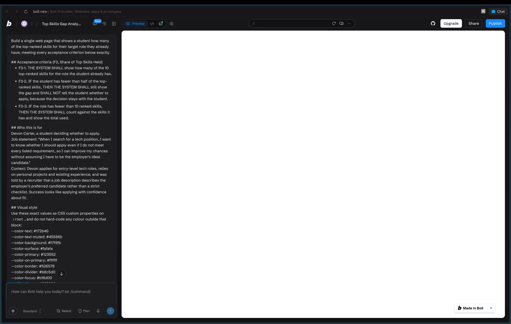
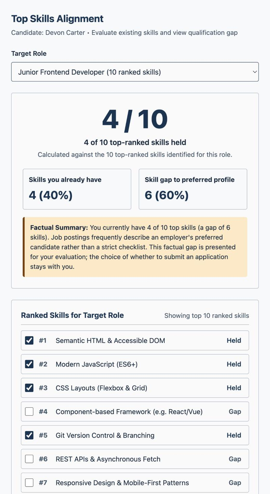

# HW6: Two Builders, One Specification

> Replace every line in angle brackets. A README that still carries template placeholders loses points.

## Feature

**Team repository:** https://github.com/aaronsarasota04/mgt3745-team-gamma
**Spec provenance:** copied from commit `5abbc1c5509800ce9898e9935eafdf94cf694cc0` on 2026-10-20

The team's `context/STYLE.md` and `context/SKILLS.md` are still Phase 2 preview
stubs on `main`, so this repository carries my own HW5 versions of those two
files, as the assignment allows. Every other file in `context/` is the team's,
unchanged, at the hash above.

**Feature:** F3, Share of Top Skills Held (J-Devon). Performance class.

EARS rows, copied unchanged from the team's `FEATURES.md`:

- F3-1. THE SYSTEM SHALL show how many of the 10 top-ranked skills for the role the student already has.
- F3-2. IF the student has fewer than half of the top-ranked skills, THEN THE SYSTEM SHALL still show the gap and SHALL NOT tell the student whether to apply, because the decision stays with the student.
- F3-3. IF the role has fewer than 10 ranked skills, THEN THE SYSTEM SHALL count against the skills it has and show the total used.

Teammates took the other features: Aaron F1, Prince F2.

## See It Work

| bolt.new | AI Studio |
|---|---|
|  |  |

<Replace the two images above with your own screenshots, or one side-by-side GIF.>

## Status

<One or two sentences: how many EARS rows each builder satisfied, and your recommendation in one line.>

## How to Run the Evals

```bash
npm test
```

<Say what the test checks and what output to expect.>

## Links

- [EVALS.md](EVALS.md): Prediction Stake and error log
- [COMPARISON.md](COMPARISON.md): evidence, spec gaps, and recommendation
- [JUDGMENT.md](JUDGMENT.md): judgment eval and agreement rate
- [prompts/PROMPT.md](prompts/PROMPT.md): the exact input both builders received
- [builds/](builds/): bolt.zip and aistudio.zip
- [docs/DDR-001.md](docs/DDR-001.md) (bolt.new), [docs/DDR-002.md](docs/DDR-002.md) (AI Studio)
- Team pull request or issue: <URL>
- Deployed Worker (only if you completed the proxy step): <URL>

## Hours

<Total hours spent, with a one-line breakdown.>

## AI Use

<Every tool that wrote more than a line or two, each with a link to its DDR.>
